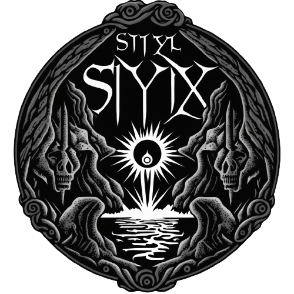
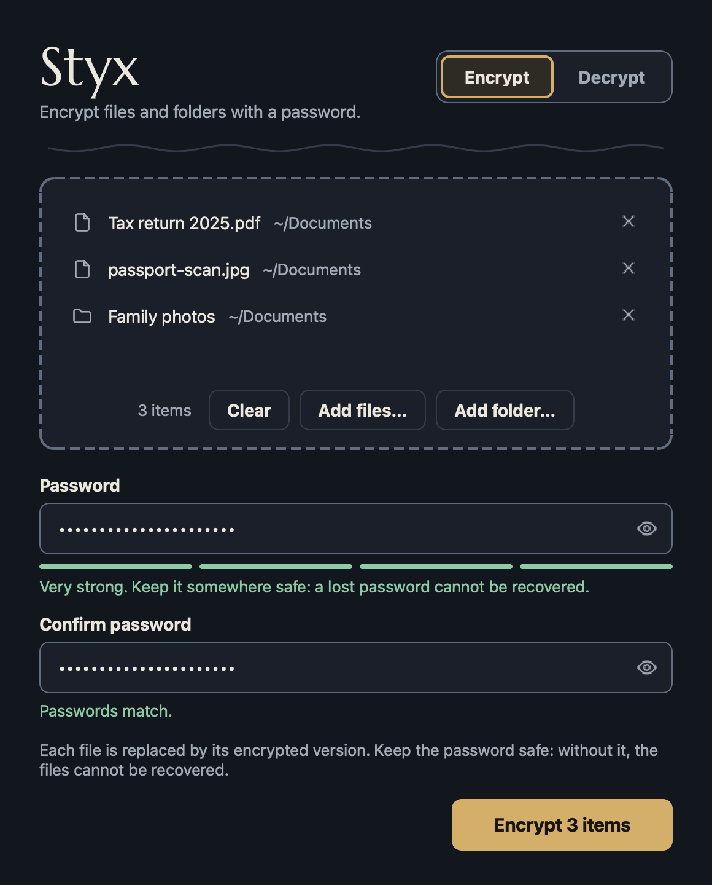
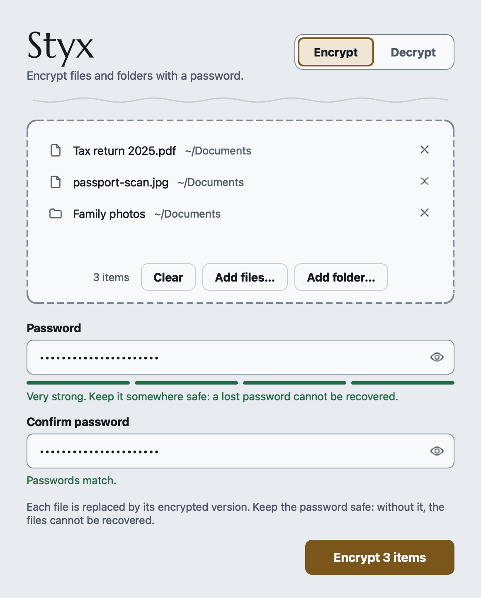
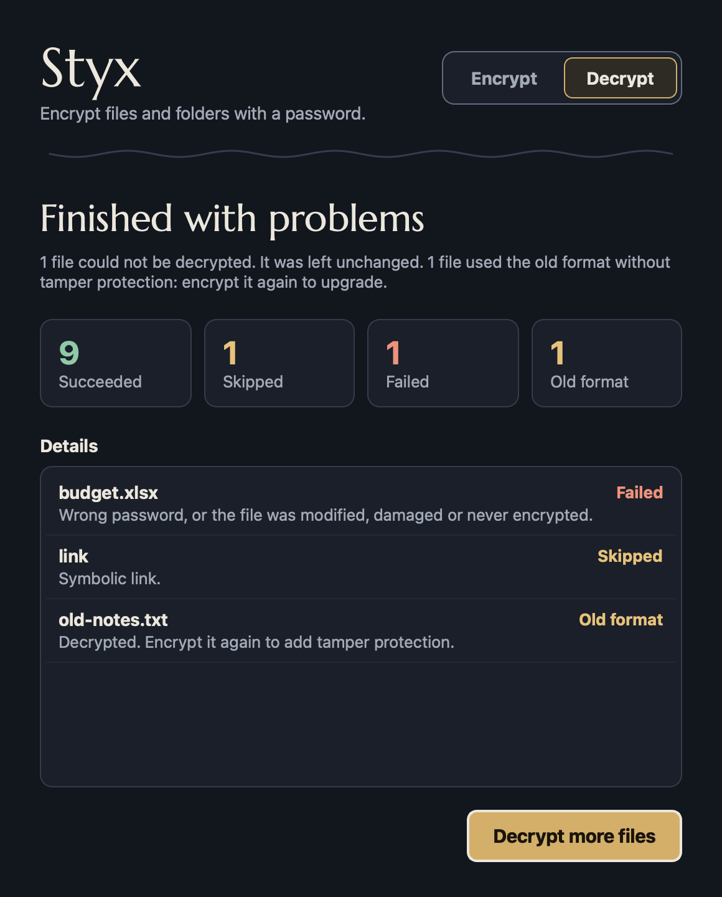
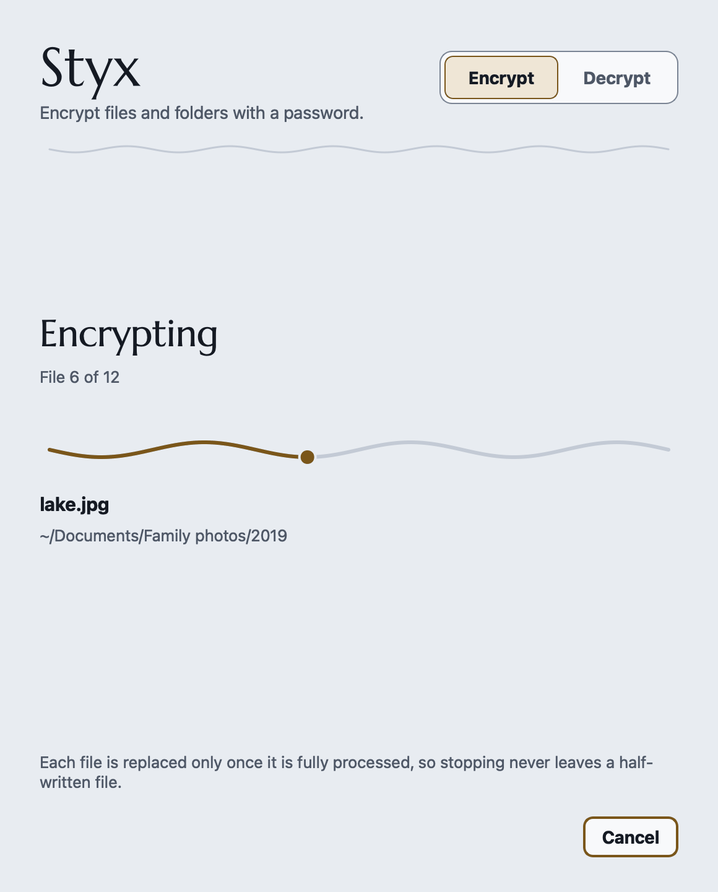

<p align="center">

</p>

# Styx

Styx encrypts and decrypts files and folders with a password. It has a small
desktop GUI (PyQt5) and a command-line interface.

Files are encrypted with **AES-256-GCM** (authenticated encryption) using a
key derived from your password with **Argon2id**. Any modification of an
encrypted file, or a wrong password, is detected and reported; the file is
then left untouched.

## Install

Python 3.9 or newer is required.

```bash
python -m venv .venv
source .venv/bin/activate          # Windows: .venv\Scripts\activate
pip install -r requirements.txt    # cryptography>=44, PyQt5>=5.15
```

`requirements.txt` replaces the former `requirement.txt`.

## Usage

### GUI

```bash
python menu.py
```

Pick **Encrypt** or **Decrypt**, drop files or folders on the window (or use
**Add files…** / **Add folder…**), type the password (twice when encrypting,
with a strength indicator) and start. Files are processed one by one in the
background with a progress bar; at the end, Styx shows how many files
succeeded, were skipped or failed, and why.

The window follows the system light or dark appearance (set `STYX_THEME=dark`
or `STYX_THEME=light` to force one). Keyboard: `Ctrl+O` add files,
`Ctrl+Shift+O` add a folder, `Ctrl+1` / `Ctrl+2` switch mode, `Enter` start,
`Esc` cancel, `Delete` remove the selected item.

| Dark | Light |
|---|---|
|  |  |
|  |  |

To build a standalone app with PyInstaller:

```bash
pip install pyinstaller
pyinstaller --onefile --windowed --name Styx --icon Styx.ico \
  --add-data "Styx_icon.png:." --add-data "styx/gui/assets:styx/gui/assets" menu.py
```

(On Windows, use `;` instead of `:` in `--add-data`.)

### Command line

```bash
python -m styx encrypt secret.pdf photos/
python -m styx decrypt secret.pdf photos/
```

The password is asked interactively (and confirmed when encrypting). It is
never accepted as a command-line argument, because arguments end up in shell
history and are visible to other users in the process list. The exit code is
`1` if any file failed.

### Behaviour

- Encryption and decryption are **in place**: a file keeps its name and its
  content is replaced. No copy of the original is kept, so keep a backup of
  anything you cannot afford to lose (and of your password).
- Folders are processed recursively. Symbolic links are skipped.
- The replacement is atomic: Styx writes to a temporary file in the same
  folder and renames it over the original only once everything succeeded. A
  wrong password, a damaged file or a full disk never leaves a half-written
  file.
- Files that are already Styx-encrypted are skipped when encrypting (no
  double encryption).

### As a library

```python
from styx import encrypt_file, decrypt_file, encrypt_folder, decrypt_folder, InvalidFileError

encrypt_file("notes.txt", password)
try:
    decrypt_file("notes.txt", password)
except InvalidFileError:
    print("wrong password or corrupted file")

report = encrypt_folder("documents", password)   # FolderReport(processed, skipped, failed, legacy)
```

## File format (v1)

All integers are unsigned big-endian.

| Offset | Size | Field          | Value                                  |
|-------:|-----:|----------------|----------------------------------------|
| 0      | 4    | magic          | `STYX`                                 |
| 4      | 1    | version        | `0x01`                                 |
| 5      | 1    | KDF id         | `0x01` = Argon2id                      |
| 6      | 4    | time cost      | Argon2id iterations (default 3)        |
| 10     | 4    | memory         | Argon2id memory in KiB (default 65536) |
| 14     | 4    | parallelism    | Argon2id lanes (default 4)             |
| 18     | 4    | chunk size     | plaintext bytes per chunk (default 65536) |
| 22     | 16   | salt           | random, per file                       |
| 38     | 8    | nonce prefix   | random, per file                       |
| 46     | ...  | chunks         | see below                              |

The plaintext is split into chunks of `chunk size` bytes; only the last chunk
may be shorter (an empty file produces one empty chunk). Each chunk is stored
as its AES-256-GCM ciphertext followed by the 16-byte tag, where:

- **key** = Argon2id(password (UTF-8), salt, time cost, memory, parallelism), 32 bytes
- **nonce** = nonce prefix (8 bytes) ‖ chunk index (4 bytes)
- **associated data** = the 46-byte header ‖ final flag (`0x01` for the last chunk, `0x00` otherwise)

Consequences:

- The header is authenticated: changing the KDF parameters, salt or chunk size
  makes decryption fail.
- Chunks cannot be reordered or duplicated (the index is in the nonce), and
  the file cannot be truncated or extended (the final flag).
- Files of any size are processed in constant memory (up to 2^32 chunks,
  i.e. 256 TiB with the default chunk size).
- A wrong password and a modified file produce the same error on purpose.

When reading, Styx rejects headers with out-of-range parameters (e.g. more
than 4 GiB of Argon2id memory) before running the KDF, so a crafted file
cannot exhaust memory.

Note that chunks are verified one at a time; the decrypted output is written
to a temporary file and only replaces the encrypted file once every chunk has
been verified.

## Migrating from older versions (format v0)

Styx 3.x and earlier wrote `salt (16) ‖ IV (16) ‖ AES-256-CBC ciphertext` with
PKCS7 padding and a PBKDF2-HMAC-SHA256 key (100 000 iterations). That format
has **no integrity protection**: modifications are not reliably detected, and
a wrong password is only caught by the padding check (which accepts a wrong
password about once in 256 tries, producing garbage).

Styx can still **decrypt** v0 files (any file that does not start with
`STYX` is treated as v0), and it warns you when it does. It never writes v0.
To migrate, decrypt your old files and encrypt them again:

```bash
python -m styx decrypt old-folder/
python -m styx encrypt old-folder/
```

## Threat model

Styx protects the **confidentiality and integrity of files at rest** against
someone who obtains the encrypted files but does not know the password: a
lost or stolen disk or USB stick, a cloud copy, a backup.

It does **not** protect against:

- **A compromised computer.** Malware, a keylogger or anyone controlling the
  machine while you type the password or while files are decrypted can read
  everything.
- **Weak passwords.** Argon2id makes guessing expensive, not impossible. Use a
  long, unique passphrase. There is no recovery: a lost password means lost
  data.
- **Metadata.** File and folder names, sizes (to within a few bytes),
  timestamps and directory structure are not hidden.
- **Remnants of the plaintext.** Encrypting in place does not securely erase
  the original bytes on disk; on SSDs and copy-on-write or journaling file
  systems they may remain recoverable. Copies elsewhere (backups, cloud sync,
  editor temp files, swap) are not touched.
- **Memory forensics.** The password and keys live in process memory while
  Styx runs; Python cannot reliably wipe them.
- **Legacy v0 files**, which are not authenticated (see above).

Styx is a personal project and has not been independently audited.

## Development

```bash
pip install -r requirements-dev.txt
python -m pytest
```

The GUI tests use [pytest-qt](https://pytest-qt.readthedocs.io/) and run
headless (`QT_QPA_PLATFORM=offscreen`).

The display font, [Marcellus](https://fonts.google.com/specimen/Marcellus) by
Astigmatic, is bundled under the SIL Open Font License
(`styx/gui/assets/Marcellus-OFL.txt`).

## License

[MIT](LICENSE)
